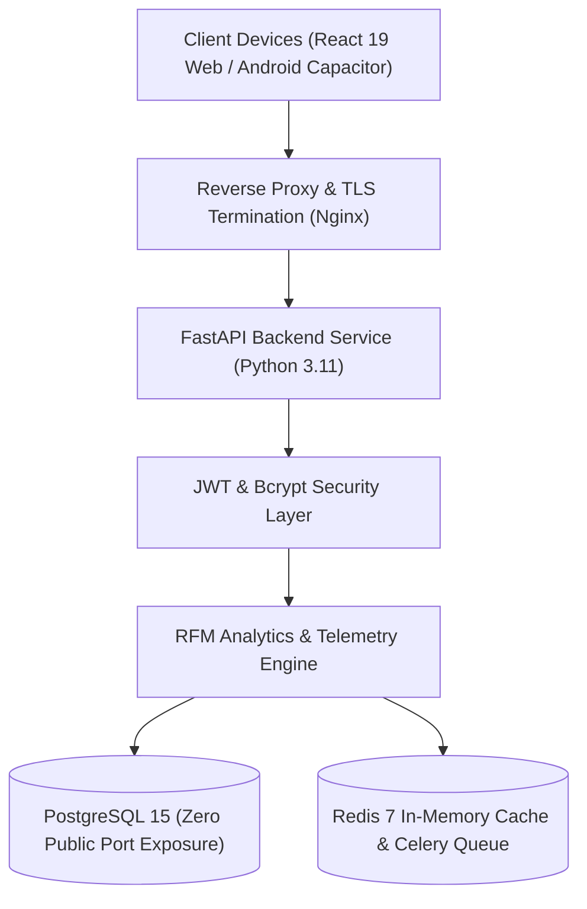

# 📊 Enterprise E-Commerce SaaS & RFM Analytics Platform

[](https://fastapi.tiangolo.com)
[](https://react.dev/)
[](https://www.postgresql.org/)
[](https://www.docker.com/)
[](https://opensource.org/licenses/MIT)

> **A production-ready, multi-tenant e-commerce intelligence and behavioral telemetry system.**  
> Engineered by **Ragada Rahmansyah** (*System Analyst & Data Analyst*).

---

## 📌 OVERVIEW

The **Enterprise E-Commerce SaaS Platform** bridges the gap between raw transactional data and actionable executive decisions. It ingests high-volume store orders, computes dynamic **RFM (Recency, Frequency, Monetary)** behavioral segmentations, and renders interactive **Dual-Axis telemetry charts** with zero cross-tenant data leakage.

### Key Capabilities:
- 🏢 **Zero-Leak Multi-Tenant Architecture:** Strict tenant-isolated database models ensuring total customer data security.
- 🎯 **Automated RFM Customer Matrix:** Segmenting customers into Champions, Loyal Customers, At Risk, and Hibernating tiers.
- 📈 **Dual-Axis Visual Telemetry:** Real-time correlation between Gross Merchandise Value (GMV), Order Volumes, and Average Order Value (AOV).
- 📱 **Cross-Platform Mobile Application:** Native Android APK integration powered by Ionic Capacitor for executives on the go.
- 🔒 **Enterprise Container Hardening:** Docker Compose deployment equipped with `no-new-privileges:true`, zero public database exposure, and isolated bridge networking.

---

## 🏗️ SYSTEM ARCHITECTURE



---

## 🛠️ TECH STACK

| Layer | Technologies |
|:---|:---|
| **Backend API** | Python 3.11, FastAPI, SQLAlchemy ORM, Pydantic v2, Uvicorn |
| **Data & ML Engine** | Pandas, Scikit-learn, Statsmodels, RFM Algorithm |
| **Frontend Web** | React 19, Tailwind CSS, Recharts, Lucide React, Vite 6 |
| **Mobile Application**| Android SDK, Ionic Capacitor 7, React, Tailwind CSS |
| **Database & Cache** | PostgreSQL 15 (Alpine), Redis 7 (Alpine), Celery Queue |
| **Security & Auth** | Passlib (Bcrypt work factor 12), Python-Jose (JWT HS256), RBAC |
| **DevOps & Infra** | Docker Compose, JSON-file log rotation, Resource CPU/RAM Quotas |

---

## 🚀 QUICK START & DEPLOYMENT

### Prerequisites
- [Docker](https://docs.docker.com/get-docker/) & [Docker Compose](https://docs.docker.com/compose/)
- Python 3.11+ (for local development without Docker)
- Node.js 20+ & npm

### 1. Clone Repository & Setup Environment
```bash
git clone https://github.com/RagadaRahmansy/ecommerce-rfm-analytics-dashboard.git
cd ecommerce-rfm-analytics-dashboard
cp .env.example .env
```

### 2. Launch with Hardened Docker Compose
```bash
docker compose up -d --build
```

### 3. Verify System Health
- **Web Application:** `http://localhost:5173`
- **Interactive OpenAPI Documentation:** `http://localhost:8000/docs`
- **ReDoc Documentation:** `http://localhost:8000/redoc`

---

## 🛡️ SECURITY & COMPLIANCE

This repository adheres strictly to the **Zero-Leak Enterprise Security Standard**:
- **Zero Public DB Exposure:** PostgreSQL (`5432`) and Redis (`6379`) are bound via `expose` (internal Docker bridge only) rather than exposed host ports.
- **Principle of Least Privilege:** All containers run with `no-new-privileges:true` to prevent host privilege escalation.
- **SQLi Protection:** 100% Parameterized queries through SQLAlchemy ORM; zero raw SQL string concatenation.
- **Secrets Management:** Zero `.env` files committed; all secrets parameterized via environment variables.

For the complete architectural guidelines and coding standards, refer to:  
👉 [**ENGINEERING STANDARDS & ARCHITECTURAL MANIFESTO (STANDARDS.md)**](STANDARDS.md)

---

## 👤 AUTHOR & CONTACT

**Ragada Rahmansyah**  
*System Analyst | Data Analyst | Data Scientist*  
- **Email:** [ragaskal123@gmail.com](mailto:ragaskal123@gmail.com)  
- **LinkedIn:** [linkedin.com/in/ragadarahmansy](https://linkedin.com/in/ragadarahmansy)  
- **GitHub:** [github.com/RagadaRahmansy](https://github.com/RagadaRahmansy)  
- **Location:** Surabaya, Indonesia

---
*Licensed under the [MIT License](LICENSE).*
